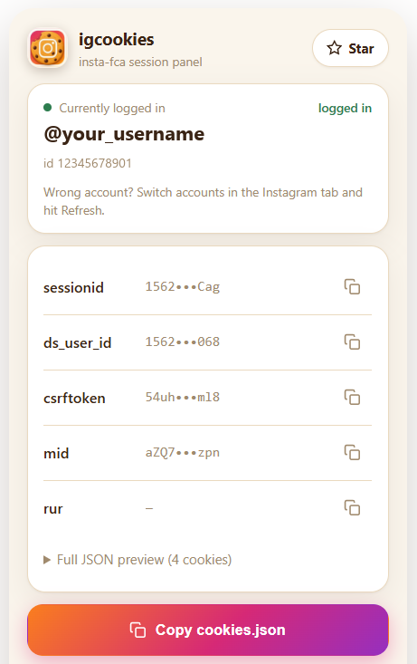

# igcookies

<p align="center">
  
</p>

<h3 align="center">Instagram Session Manager</h3>

<p align="center">
  A local-first Chrome extension for managing your own Instagram browser session in development environments.
</p>

<p align="center">
  
  
  
</p>

<p align="center">
  <a href="#features">Features</a> ·
  <a href="#download">Download</a> ·
  <a href="#installation">Installation</a> ·
  <a href="#security">Security</a> ·
  <a href="#license">License</a>
</p>

---

## About

**igcookies** is a lightweight browser extension built for developers working with Instagram integrations.

It provides a simple interface to identify the currently authenticated account and inspect locally available session information.

Designed around a straightforward principle:

> Your development environment should remain transparent, predictable, and under your control.

## Features

| Feature | Description |
|:--|:--|
| Account overview | Identify the currently recognized account |
| Session inspection | View relevant session information |
| JSON export | Organize session data into a structured format |
| Local configuration | Maintain extension-generated settings locally |
| Device settings | Manage locally stored device configuration |
| Validation | Check exported configuration structure |
| Privacy-focused | No third-party analytics or external data collection |

## Download

A short screen recording of the download steps:

<p align="center">
  <a href="assets/guide-download.mp4">
    
  </a>
</p>

<p align="center">
  ▶ <a href="assets/guide-download.mp4">Watch the video guide</a>
</p>

Prefer the files only:

1. Open the **Code** menu on the repository page.
2. Select **Download ZIP**.
3. Extract the archive.
4. Continue with Installation below.

## Installation

**Requirements**

- Google Chrome 110+
- Instagram account
- Local copy of this repository

**Setup**

1. Clone this repository.
2. Open `chrome://extensions`.
3. Enable Developer mode.
4. Select **Load unpacked**.
5. Choose the project directory.
6. Open Instagram and use the extension.

## Project Structure

```text
igcookies/
├── manifest.json
├── background.js
├── popup.html
├── popup.js
├── content.js
├── tools/
│   └── validate.js
├── assets/
│   ├── guide-download.mp4
│   └── guide-download-preview.png
└── igcookies-icon.png
```

## Architecture

The extension uses Chrome's Manifest V3 architecture.

| Component | Responsibility |
|:--|:--|
| `background.js` | Extension background operations |
| `popup.html` | User interface |
| `popup.js` | Interface interactions |
| `content.js` | Account identification |
| `manifest.json` | Permissions and configuration |
| `validate.js` | Configuration validation |

## Security

Authentication cookies are sensitive credentials.

- Never publish session data.
- Never commit personal authentication files.
- Keep exported files outside public repositories.
- Use only accounts you own or are authorized to manage.
- Revoke compromised sessions through Instagram's official security settings.

This project does not bypass authentication, two-factor authentication, or platform security verification.

## Privacy

The extension is designed for local operation.

- No third-party analytics.
- No external telemetry.
- No intentional transmission of session data to external servers.
- Locally stored extension configuration.

Review the source code and requested browser permissions before installation.

## Related Projects

**ica-unofficial**

An independent Node.js package for experimenting with Instagram integrations.

- [GitHub Repository](https://github.com/alaminnna/ica-unofficial)
- [npm Package](https://www.npmjs.com/package/@alaminnna/ica-unofficial)

## Disclaimer

igcookies is an independent, unofficial project.

It is not affiliated with, endorsed by, or associated with Meta Platforms, Inc. or Instagram.

Users are responsible for complying with applicable platform terms and policies.

## Author

**Al A Min**

Independent Developer · Open Source Builder

[GitHub](https://github.com/alaminnna) · [Website](https://alaminnna.ami.bd) · [LinkedIn](https://linkedin.com/in/alaminnna/)

## License

MIT License.

See [LICENSE](LICENSE) for details.

---

<p align="center">
  <sub>Designed and maintained by <a href="https://github.com/alaminnna">Alaminnna</a>.</sub>
</p>
